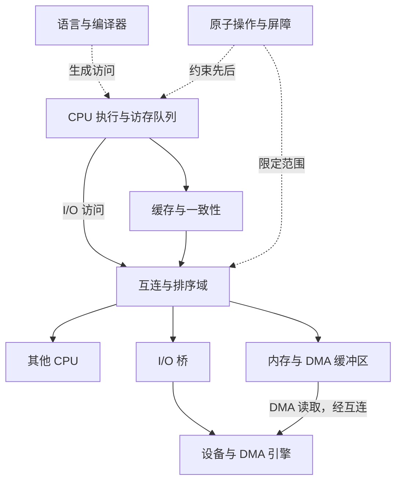

# Ordering Lab · 计算机系统顺序实验室

Interactive visual experiments exploring CPU execution, memory ordering, multicore synchronization, and I/O ordering, with planned PCIe transaction simulations.

用可交互实验理解计算机系统中的“先后”：程序顺序、CPU 内部执行顺序、访存可见顺序，以及设备事务和完成状态。

**在线实验：** https://marsdoge.github.io/ordering-lab/

支持播放 / 暂停、前后单步、时间轴拖动、速度调节、键盘快捷键、场景链接和离线 HTML 下载。响应式中文界面，无运行时依赖、追踪器或外部字体。

## 先看数据流，再看顺序保证

页面由可点击的数据流图和从上往下读的双参与者时序图组成。选择一次操作或播放到某一步，会高亮涉及的环节；点击节点查看它负责保证什么、不能据此推导什么。切换架构和同步开关，可以直接对照结果与机器级同步示例。



这是逻辑关系图，不是固定硬件布线；数据可见不意味着已经写回 DRAM。网站用蓝色实线区分数据 / 事务路径、灰线表示指令流，并用单独的虚线链解释顺序保证。屏障约束访问的先后，不等于沿数据路径移动的一份数据。

已支持 **LoongArch、x86-64、AArch64、RISC-V**。普通内存模型分别以可缓存共享内存、x86 WB、AArch64 Normal（示例限定适当共享域）、RISC-V 默认 RVWMO 为前提；RISC-V 示例不包含 Ztso。DBAR 内部协作实验专用于 LoongArch。

## 已实现的实验

| 分类 | 实验 | 重点 |
| --- | --- | --- |
| 单核 | 自己写，自己读 | 存储转发与对外可见性不同 |
| 单核与设备 | CPU + 一致性 DMA | 写写排序与发布协议 |
| 多核 | 数据与旗标 | 四架构对照、无同步反例、release/acquire |
| 多核 | Store Buffering | x86 也允许双零，双完整屏障排除双零 |
| DMA | DBAR 不会清理缓存 | 非一致性 DMA 的缓存维护与所有权 |
| 设备 I/O | 写到、收到、做完 | Posted MMIO、回读与设备完成确认 |
| 屏障 | 乱序 CPU 怎样守住 DBAR | 指令年龄、未完成访存、独立计算 |

## 计划扩展

- CPU 流水线、多发射、乱序执行与按序退休的独立实验。
- 多核缓存一致性、原子操作与锁。
- PCIe 请求 / Completion、Posted / Non-Posted 事务、Relaxed Ordering 等规则。
- 更细的 AArch64 共享域、RISC-V Ztso 与不同内存属性对比。

以上为路线图，尚未实现的功能不会作为可运行实验展示。PCIe 模型需要标注规范版本、事务类型和适用条件，不把简化示意当作完整协议模拟器。

## 本地使用

需要 Node.js 20 或更新版本，无需安装依赖。

```sh
git clone https://github.com/MarsDoge/ordering-lab.git
cd ordering-lab
npm test
npm run build
```

直接用浏览器打开 `dist/index.html`，即可离线使用。页面底部也提供单文件 HTML 下载。

快捷键：空格播放 / 暂停，左右方向键单步。焦点在按钮、链接或表单控件上时，保留控件自身的键盘行为。

## GitHub Pages 部署

仓库内已提供 `.github/workflows/pages.yml`。默认分支为 `master`：

1. 首次到仓库 **Settings → Pages → Build and deployment → Source**，选择 **GitHub Actions**。
2. 打开 **Actions → Test and deploy Ordering Lab → Run workflow**，选择 `master` 并运行。若首次推送时 Pages 尚未启用，先完成第 1 步再重跑。
3. `Test and build` 与 `Deploy GitHub Pages` 均成功后访问上面的 Pages 地址。

之后推送到 `master` 会自动运行测试、构建并发布；Pull Request 只测试和构建，不部署。工作流使用 GitHub 自带的临时令牌，不需要添加个人访问令牌。

构建产物使用内联 CSS / JavaScript 和片段链接，适用于 `/ordering-lab/` 这样的项目子路径，也可直接离线打开。

仓库保留了可选的 `vercel.json` 和 `wrangler.jsonc`：Vercel / Cloudflare Pages 的构建命令为 `npm run build`，输出目录为 `dist`。GitHub Pages 是本项目的主要发布方式。

## 源码结构与扩展

```text
src/model.mjs       四架构规则、执行路径、数据流节点与顺序约束
src/app.mjs         播放器、双参与者时序、数据流联动与渲染
src/styles.css     响应式布局与动画
src/shell.html     页面骨架
scripts/build.mjs  生成单文件 HTML，并保留 MIT 许可声明
tests/             状态模型的关键不变量与反例验证
```

当前有 8 项模型测试，覆盖四架构消息发布、Store Buffering、存储转发、DMA 缓存维护、MMIO 完成确认、DBAR 和图节点关系。这些是教学模型的不变量测试，不是 ISA 形式化验证。

新增实验时，先明确参与者、初始状态、访问类型和排序约束，再定义允许的执行轨迹。测试应验证关键结果，例如屏障后哪些结果被禁止，而不仅是复述实现。

## 教学模型的边界

动画展示一种被允许的离散执行，不是周期精确模拟器，也不代表芯片性能。较强序不代表顺序一致；缓存一致性不等于内存序，CPU 核间一致也不必然意味着 DMA 一致。

机器级伪代码与 C/C++ 并发模型须区分：不要把普通变量的数据竞争当作合法实验。实际驱动必须遵循内存属性、DMA API 和设备协议。

DBAR 的内部实现示意是概念解释，不声称描述龙芯 3A6000 的未公开实现。

## 技术依据

- [LoongArch Volume 1](https://loongson.github.io/LoongArch-Documentation/LoongArch-Vol1-EN.html)：DBAR / IBAR、MAT。
- [Intel SDM](https://www.intel.com/content/www/us/en/developer/articles/technical/intel-sdm.html)：普通 WB 内存序及 Store→Load 例外。
- [Arm Memory Consistency Examples](https://learn.arm.com/learning-paths/servers-and-cloud-computing/memory_consistency/examples/)：消息发布、DMB、STLR / LDAR。
- [Arm Barrier Scope](https://support.arm.com/documentation/102336/0100/Limiting-the-scope-of-memory-barriers?lang=en)：共享域与屏障范围。
- [RISC-V RVWMO](https://docs.riscv.org/reference/isa/unpriv/rvwmo.html) 与 [Memory Model Explanatory Material](https://docs.riscv.org/reference/isa/unpriv/mm-eplan.html)：默认弱序与 FENCE。
- [Linux Memory Barriers](https://docs.kernel.org/core-api/wrappers/memory-barriers.html)。
- [Linux DMA API HOWTO](https://docs.kernel.org/core-api/dma-api-howto.html)。
- [Linux Device I/O](https://docs.kernel.org/driver-api/device-io.html)：posted writes 与回读。

## License

[MIT License](LICENSE) · Copyright (c) 2026 Dongyan Qian.
